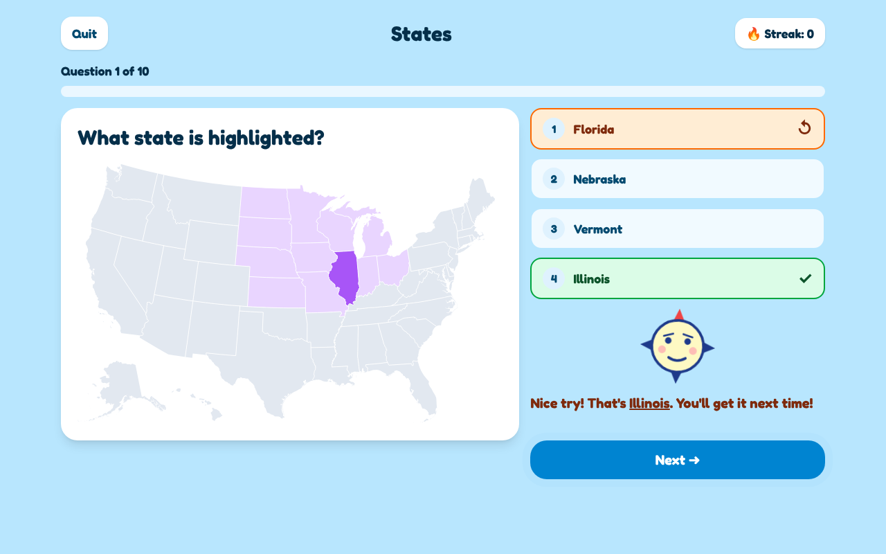

# US Geography Quiz

A friendly map quiz that helps a 5th grader learn the US regions, states and capitals. Pick a mode, look at the highlighted part of the map, choose one of four answers, and get instant, encouraging feedback.

**Play it online:** https://mbetzel.github.io/us-regions-states-capitals-app/ (redeployed automatically by GitHub Actions on every merge to `main`). Progress is saved in that browser only.



## What you need

- WSL (Ubuntu)
- Node 22, installed inside WSL with [nvm](https://github.com/nvm-sh/nvm). The `.nvmrc` file already says which version.
- Keep the project on the WSL filesystem (for example `~/projects`), not under `/mnt/c`. It is much faster.

## Set up

```bash
git clone https://github.com/mbetzel/us-regions-states-capitals-app.git   # first time
cd us-regions-states-capitals-app
git pull                                                                   # later, to get updates

nvm install   # first time only; reads .nvmrc
nvm use
npm install
```

## Run it

```bash
npm run dev
```

Then open <http://localhost:5173> in your Windows browser (WSL forwards the port).

To try the production build instead:

```bash
npm run build && npm run preview
```

and open the address it prints (usually <http://localhost:4173>).

## How to play

- Home has three modes: **Regions** (7 questions per round, one per region), **States** and **Capitals**.
- Choose 10, 20 or All questions per round (Regions always has 7).
- The map highlights the area in the region's color. Tiny states such as Rhode Island get a pulsing ring so they are easy to spot. In Capitals mode a gold star marks the capital.
- Pick an answer by tapping it, or press **1** to **4**. After answering, press **Enter** or **Space** (or tap Next) to continue.
- The results screen shows the score and 1 to 3 stars. Missed items are listed, and **Practice missed ones** drills just those.
- **Practice my mistakes** makes questions you have missed before show up more often.
- **Sound effects** can be switched on and off. The choice is remembered.
- **Reset my progress** erases stars and history (it asks first).
- Refreshing the page in the middle of a round picks up where you left off.

### Region colors

| Region       | Color            | States                              |
| ------------ | ---------------- | ----------------------------------- |
| New England  | blue             | ME NH VT MA RI CT                   |
| Mid-Atlantic | deep purple      | NY PA NJ DE MD                      |
| Southern     | green            | KY WV VA AR TN NC LA MS AL GA SC FL |
| Midwest      | purple           | ND SD NE KS MN IA MO WI IL MI IN OH |
| Southwest    | orange           | AZ NM OK TX                         |
| Pacific      | light red / pink | WA OR CA AK HI                      |
| Mountain     | brown            | ID MT WY NV UT CO                   |

## Where your progress is saved

In your browser's `localStorage` (key `usgeo:v1`). Nothing is sent anywhere. Progress is per browser, so Chrome and Edge each keep their own, and clearing site data erases it.

## For developers

| Command               | What it does                                                                              |
| --------------------- | ----------------------------------------------------------------------------------------- |
| `npm run lint`        | ESLint                                                                                    |
| `npm run build`       | Type-check and production build into `dist/`                                              |
| `npm test`            | Unit and component tests (Vitest)                                                         |
| `npm run e2e:install` | One-time download of Chromium and its system libraries for Playwright (needs sudo in WSL) |
| `npm run e2e`         | End-to-end tests (Playwright, builds and serves the app itself)                           |
| `npm run format`      | Prettier, writes changes (`npx prettier --check .` to only check)                         |

```
src/
  data/        regions and the 50 states (with capitals), plus data tests
  map/         US map rendering (d3-geo + us-atlas) and highlight logic
  quiz/        pure quiz engine and seeded random numbers
  store/       Zustand store persisted to localStorage
  components/  buttons, mascot, stars, progress bar, feedback
  screens/     Home, Quiz, Results
  lib/         sound, confetti, praise, helpers
e2e/           Playwright tests
docs/          architecture and QA report
```

More detail: [docs/ARCHITECTURE.md](docs/ARCHITECTURE.md) and [docs/QA-REPORT.md](docs/QA-REPORT.md).
